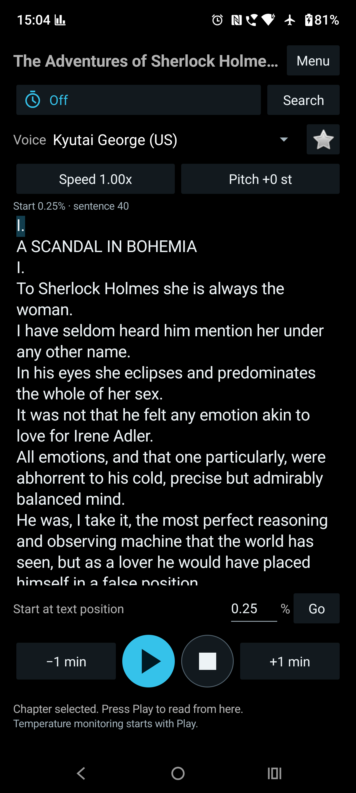
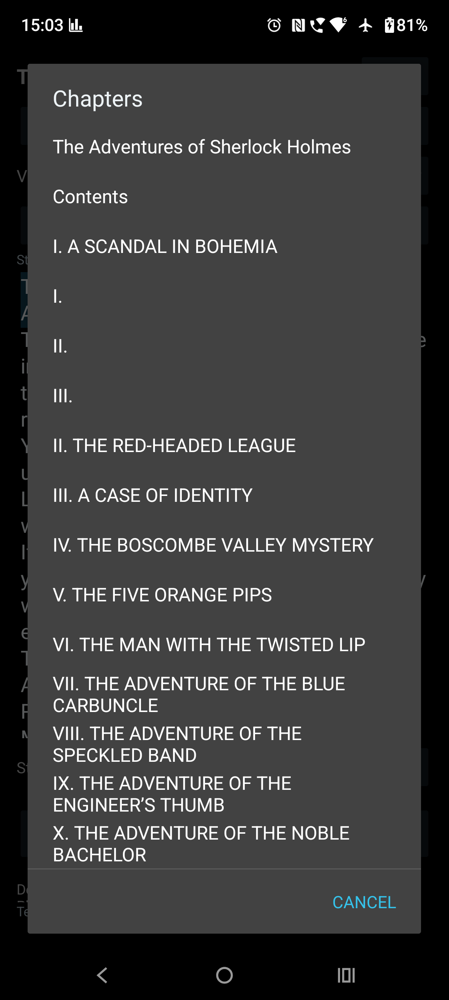

# PockeTTS

An offline Android document reader built on [Kyutai Pocket TTS](https://github.com/kyutai-labs/pocket-tts).
It reads EPUB, DOCX, and TXT documents aloud with natural-sounding voices. All speech is generated on the phone.

**The PockeTTS app code and project-specific changes were fully AI-generated.**
The upstream speech model and libraries are the work of their credited authors. I did not create or train the Pocket TTS model.
PockeTTS is an independent project. It is not an official Kyutai or Gradium app.

## Tested devices

This is a personal project, shared as-is. I tested it on two devices only:

| Device | Menu > Phone type |
| --- | --- |
| Motorola Edge 60 Pro | Fast phone (best voice) |
| HiSense Touch Lite (e-ink audio player) | Slower phone (lighter model) |

I hear no quality difference between the two settings. I cannot test other phones, and there is no device compatibility guarantee.

## Features

- Fully offline. The app has no Internet permission. You copy the runtime ZIP and the voice files to the phone yourself.
- Speech starts almost at once, also after you change the voice.
- EPUB chapters, DOCX headings, and TXT files.
- The reading position is saved for each file name.
- Sentence highlighting, text following, phrase search, and position controls.
- The chapter name and the estimated listening time (read and total) above the controls.
- Background playback, voice favorites, and a sleep timer that remembers its last duration.
- Separate speed and pitch controls. Sound and device support for these controls need more testing.
- Light and dark theme, following the phone's system setting.

PockeTTS is a standalone reader. It is not an Android system text-to-speech service.
It uses one pinned English model. Other languages and other Pocket TTS model versions do not work with it.

## Screenshots

From my Motorola Edge 60 Pro, with Kyutai George. The book is Arthur Conan Doyle's *The Adventures of Sherlock Holmes* ([Project Gutenberg ebook 1661](https://www.gutenberg.org/ebooks/1661)). The EPUB is not included in this repository.

  
  

## Install and use

This repository does not contain an APK or the model weights. You build the APK and the runtime ZIP yourself. See [BUILDING.md](BUILDING.md).

You need an ARM64 device with Android 8 (API 26) or newer, and about 220 MB of free storage for the runtime ZIP, plus space for the voices.

1. Install the APK.
2. Copy `pocket-runtime.zip` and one or more files from [voices](voices) to the phone.
3. Select **Menu > Setup > Import runtime ZIP** and select the runtime ZIP.
4. Select **Menu > Setup > Import voice profiles** and select the `.pttsvoice` files.
5. On a slower phone, select **Menu > Phone type > Slower phone (lighter model)**.
6. Select **Menu > Open document**, choose a book, select a voice, and press **Play**.

## Voices

The 15 supplied voices are Kyutai's own voices, made from Kyutai's selected source audio. No personal voices and no voice-creation tool are included.
These voice files are this project's own packaging. They are not exact copies of Kyutai's preset voice files.

**Jean uses CC BY-NC 4.0 and is for non-commercial use only.** The other voices use CC BY 4.0 or CC0. See the [voice list and credits](voices/README.md) before reuse.

You can also import other `.pttsvoice` profiles:

1. Get a profile made for this app's exact model (see [VOICE_FORMAT.md](VOICE_FORMAT.md)). Check its source, licence, and permitted use.
2. Copy it to your phone's Downloads folder.
3. Select **Menu > Setup > Import voice profiles** and select the file.

The app cannot import WAV or MP3 recordings, or a Pocket TTS `.safetensors` file on its own. Renaming a file does not make it a profile.
The app rejects profiles made for other Pocket TTS models.

## Changes and support

I do not offer troubleshooting, issue triage, or pull request review.
If you want changes, fork the repository and test them on your own device. You can ask your own AI coding tool to make or fix them. Give it [AGENTS.md](AGENTS.md) and [BUILDING.md](BUILDING.md) first.
Passing automated tests does not prove device compatibility or good speech quality.

## Credits

| Source | Version used | Credit and use |
| --- | --- | --- |
| [Kyutai Pocket TTS](https://github.com/kyutai-labs/pocket-tts/tree/a922b912dfa366975294afb568d815b305acde5d) | v4.0.1; commit `a922b912dfa366975294afb568d815b305acde5d` | Speech model, Rust runtime modules, model configurations, tokenizer integration, and streaming synthesis. MIT licence. |
| [Gabriel de Marmiesse's xn-ptts branch](https://github.com/gabrieldemarmiesse/xn-ptts/tree/7efa26973f81bba42cf2ace8da2c1eb9b605d54d) | commit `7efa26973f81bba42cf2ace8da2c1eb9b605d54d` | Native model operations. The dependency pinned by Kyutai, based on [Gradium's xn-ptts](https://github.com/gradium-ai/xn-ptts). MIT OR Apache-2.0. |
| [Laurent Mazare's xn](https://github.com/LaurentMazare/xn) | 0.2.12 (Cargo.lock) | Tensor library used by the runtime. MIT OR Apache-2.0. |
| [173 other Rust crates](licenses/rust-crates.md) | Cargo.lock | Compiled into the native library. Each keeps its own licence: mostly MIT and Apache-2.0; the Symphonia audio crates use MPL-2.0. |
| [Kyutai voice collection](https://huggingface.co/kyutai/tts-voices) | revision `323332d33f997de8394f24a193e1a76df720e01a` | Source recordings for the 15 supplied voices. Each voice has its own licence. |

Model revision: `db04f0e653473e5c7333c69686ac92b7460b0c1d`. Tokenizer revision: `00eac05ed3d16bdc3f6b5d598874019c34a89214`.
All checksums are in [runtime-contract.json](android/app/src/main/assets/runtime-contract.json). Full licence details are in [THIRD_PARTY.md](THIRD_PARTY.md).

This project added:

- The Kotlin Android reader: document import, chapters, saved positions, controls, and the playback service.
- A C interface and JNI bridge between the Rust runtime and Android audio.
- Local-only loading and checks of the runtime and voice files.
- Packaging of the Kyutai voices into the `.pttsvoice` format.
- Reader tests and offline build checks.

The native library keeps the upstream Rust code. It is not a new speech engine. [native/provenance.json](native/provenance.json) lists the copied and changed modules.

## Licence

PockeTTS-specific code uses the [MIT licence](LICENSE).
Upstream code and the voices keep their own licences (see [THIRD_PARTY.md](THIRD_PARTY.md)).
The model weights come from Kyutai. Follow Kyutai's model terms and voice-use restrictions.
